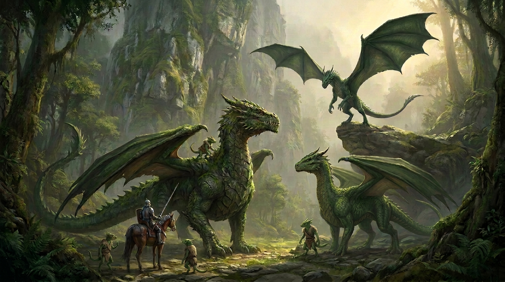
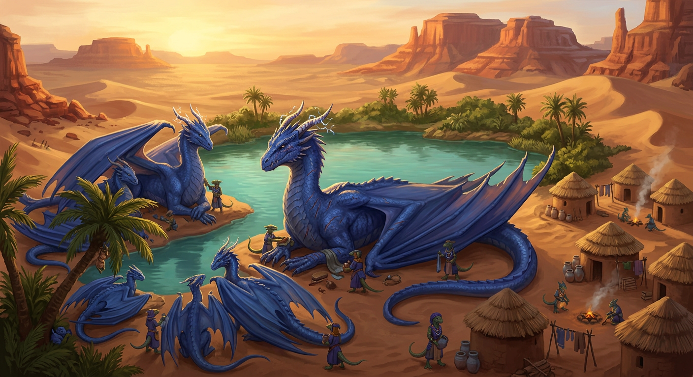

# Dragon Ecology

*A working natural history of dragons. Numbers are back-of-envelope; assumptions are stated so they can be changed.*

Baseline assumption: an adult female of about 8–9 t, roughly a large elephant, with an elongated profile (long neck and tail). Length is nose to tail tip and scales with mass^⅓; wingspan is about 2.5× length. Flight at that size is a problem, addressed under **Flight**.

## Life History

| Stage | Age | Mass (♀) | Length | Wingspan | Notes |
|---|---|---|---|---|---|
| Hatchling | 0–5 | 10 → 250 kg | 1.5 → 4 m | 4 → 11 m | Fed regurgitated meat by the whole pod, as pigeons and crocodilians do |
| Juvenile | 5–20 | to ~3 t | ~10 m | ~25 m | Fast, sauropod-style growth; most mass is gained here |
| Subadult | 20–40 | to ~7 t | ~13 m | ~33 m | Slow finish. Armor thickens, males disperse |
| Breeding | 40–~80 | 8–9 t | ~14 m | ~35 m | One egg (rarely two) about every 5 years: 8–11 eggs in a lifetime |
| Post-reproductive | 80–100+ | 9–10 t | 14–15 m | 36–37 m | Matriarch. Laying stops; knowledge becomes her job |

- **Orca model.** Orcas have a post-reproductive grandmother phase, and it fits the 100-year cap well.
- **Survival maths.** Replacement needs about 1 surviving daughter per female. With ~10 eggs and a 50/50 sex ratio, only ~20% of hatchlings need to reach 40. That means about 4% annual juvenile mortality and about 3% adult mortality.
- **Rare elders.** Only 10–20% of females live to 90 or more, so a 95-year-old matriarch is a rarity.
- **Slow recovery.** Generation time is about 60 years, so dragons can't recover from hunting. Doubling a population takes decades.
- **Males die younger.** They are smaller (~5 t), about 60% of female mass. They mature physically at ~25–30 but can't win fights until ~40–45, and they rarely pass 80. This matches orcas and elephants.

## Social Structure

The model is mostly elephant and orca, with some hyena.

- **Matriline.** A pod of 5–9 is a matriarch, her sisters, daughters, granddaughters and the young. Females stay in the pod for life. The matriarch's authority comes from age and knowledge, not just size.
- **Clans.** Several related pods that share a "dialect" and a territory form a clan, as in resident orcas. Pods meet and merge at fixed rendezvous (fission–fusion).
- **Males.** Males leave at about 15–20, as elephant bulls do.
  - **Bachelor groups:** young males travel in small groups.
  - **Consorts:** they visit pods only in a brood year, when the matriarch has synchronized the females. Males must be unrelated to the pod.
  - **Coalitions:** 2–3 brothers may hold a prime territory together, like lions or dolphins.
  - **Old males:** solitary and settled, with a fixed lair and a reputation.
  - **Sentinels:** in contested or human-heavy country, a tolerated male can live at the pod's edge, like a hyena clan's low-ranking immigrant male.
- **Nest temperature.** If sex is set by nest temperature, as in crocodilians, the matriline can bias its sex ratio. In lean years it would produce more females or more males depending on what the pod needs.

## Food and Territory

- **Metabolism.** Assumed mesotherm, roughly 40% of a mammal's rate at the same mass: about 1% of body mass per day, or **50–80 kg/day** for an adult female.
- **Pod demand.** A pod of 7 totals about 30 t, so it needs roughly 250 kg/day, or **~90 t a year**.
- **Territory.** Scaled from tigers using Kleiber's law, a pod needs about **1,000 km²** (400–3,000 depending on productivity), or one dragon per ~130 km². A region the size of Portugal would hold perhaps 60 pods at most, and far fewer once farmland has displaced wild prey.
- **Diet.** About half is meat (deer, wild cattle, carrion), plus mast, fruit, tubers and bone. Geophagy at mineral licks matters because of the armor (see below).

## Livestock Raiding

- **Cost to humans.** A pod eating only sheep would need about 8 a day, or ~3,000 a year. Even at 25% of the diet that is ~700 sheep or ~100 cattle a year. A 500-sheep village loses everything, so a pod must spread raids across 10–20 steadings.
- **Behavior.** Livestock are dense, slow and predictable, so the payoff is high. Raiding pushes dragons toward the orca "transient" lifestyle: small, silent groups of 2–4 that hunt mammals and avoid contact, unlike the loud, vocal "resident" pods.
- **Social effects.**
  - Pods split into raiding units, and bold individuals die first, which selects for caution.
  - The matriarch's key knowledge becomes where the humans are and what they can do, so losing her is catastrophic.
  - Young bachelors raid first. In elephants, crop raiders are mostly young males, and the same would hold here.
- **Central-place rule.** Like most predators, they raid 20–60 km from the lair, not near it.
- **Human response.** Poison, bounties and wards raise adult mortality, and the population can't absorb that.
- **Mutualism with herders.** Following the transhumance routes (flocks go up to summer pasture) gives a long-running protection racket. Dragons keep rival predators off the flock in exchange for a tithe.

## Migration Cycles

Not everything is annual. Four layered cycles:

1. **Annual:** seasonal movement between highland summer ground and warm lowland or geothermal winter ground, often following transhumance. The long legs are flown in a day or two, with the matriarch leading, and the pod walks within each ground.
2. **Brood cycle (~5 years):** return to ancestral hatcheries, like sea turtles returning to natal beaches. Pods skip a brood year in lean times.
3. **Climate cycle (~7 years):** an ENSO-like drought and flood pattern that forces long-range movement, with irruptions like snowy owls.
4. **Generational (30–60 years):** a mast year, a bamboo-style mass fruiting, or volcanic activity. Only matriarchs remember it. In real elephant and orca studies, groups led by older females survive droughts and prey collapses better; this is the mechanism for 100-year matriarchs.

## Flight

**Body plan.** At 8.5 t and a density near water, the body is about 9 m³: a ~3.5 m torso, a ~2.5 m neck, a ~6 m tail and a ~0.8 m head, for roughly **14 m** overall and a shoulder height near 2.5–3 m. Males (~5 t) are about 11–12 m.

**Wings.** Lift gas doesn't work at this scale, because hydrogen lifts only about 1 kg per m³ and the whole animal is ~9 m³. Flight has to come from wings, and the numbers are large:

- Span about **35 m**, area about 200 m², wing loading about 40 kg/m² (a swan is about 20).
- Stall speed is about 75 km/h, so an adult can't take off from flat ground. It launches from cliffs and ridges and lands on slopes or water.
- Flight is mostly soaring and gliding on thermals and ridge lift, with flapping only in short bursts.

**Growth effects.** Wing loading rises with size (∝ length), so flight gets harder as dragons grow:

- Hatchlings and juveniles (loading 4–13 kg/m²) fly easily. Subadults and young adults are the scouts.
- Males (~5 t, ~29 m span, loading ~35 kg/m²) fly better than females and range farther, which fits their solitary wandering.
- The matriarch (9–10 t, loading ~43 kg/m²) can no longer fly on wings alone by about 60–70. Elder lift (below) lets her fly the long legs, but she flies rarely and anchors the pod on the ground. Within a ground, pods travel on foot at about 30–40 km/day, like elephants.

**Elder lift.** The wings and numbers above are natural, and old dragons add a magical element on top:

- Lift is a power that comes with age, like the other powers dragons gain as they grow older. It starts to appear in the 50s and 60s, as wing loading becomes too high, and by about 80 it offsets roughly half the body's weight.
- Effective loading drops to ~22 kg/m² and stall speed to ~55 km/h. That is enough to launch from a ridge or slope into a headwind and to glide long distances, but not to hover or take off in still air on flat ground.
- The matriarch flies for the long legs between grounds (a few hundred km), for river, sea and pass crossings, and in emergencies. She doesn't fly for daily movement, and a long flight leaves her tired and needing a meal.
- The same lift is why a very old matriarch is still the pod's strongest option for crossing a barrier, so she stays central to migration despite her weight.

## Movement Speeds

Walking speed scales with the square root of leg length (a Froude-number argument), and I assumed a semi-erect stance with a hip height of about 2 m for an adult female. Running is anchored to elephants (~25 km/h at 5 t) and large crocodilians. Flight cruise is about 1.3× stall speed, in a glide or soar.

| Stage | Walk | Run (burst) | Flight (cruise) |
|---|---|---|---|
| Hatchling (10 kg) | 2 km/h | 15 km/h | 35 km/h |
| Age 5 (250 kg) | 3 km/h | 35 km/h | 55 km/h |
| Juvenile (3 t) | 4 km/h | 40 km/h | 85 km/h |
| Subadult (7 t) | 5 km/h | 35 km/h | 95 km/h |
| Adult female (8.5 t) | 5 km/h | 30 km/h | 100 km/h |
| Matriarch (9.5 t) | 5 km/h | 25 km/h | ~70 km/h with elder lift, rarely flies |
| Adult male (5 t) | 4.5 km/h | 35 km/h | 90 km/h |

- **Walking:** about 5 km/h for an adult, so a 6–8 hour travel day covers the 30–40 km a pod manages on foot.
- **Running:** a mesotherm has limited anaerobic reserves, so a run lasts about 10–30 seconds and a few hundred metres, then leaves the dragon blown. A galloping horse (50–60 km/h) outruns a dragon on open ground, and so does a sheep over a short distance.
- **Flying:** cruise is about 100 km/h for an adult, and a dive can reach about 160 km/h. A thermal-soaring day can cover 300–600 km at little cost, so a 60 km raid takes under 40 minutes and a 1,000 km² territory is crossed in about 20 minutes.
- **Takeoff:** speeds are for flight in progress. An adult needs a drop or a headwind to reach stall speed, and a matriarch with elder lift needs a slope or a headwind (see Flight).
- **Tabletop conversion:** a 6-second round is 8 m at a walk (~27 ft), 50 m at a run (~165 ft) and 170 m in cruise flight (~550 ft). That is well beyond the usual 5e dragon speeds (40 ft walk, 80 ft fly), so I'd keep those for play and use these figures for travel and pursuit.

## Breath and Color

The shared mechanism is a "bombardier" system: two reagent glands feed a heat-lined mixing chamber. Capacity is limited by reagent supply, which explains why breath recharges.

| Color | Breath | Chemistry | Habitat and color |
|---|---|---|---|
| Red | Fire | Methane plus pyrophoric diphosphane from gut bacteria that process bone phosphate (the likely cause of will-o'-wisps) | Volcanic and bone-eating. Carotenoid pigment |
| Blue | Lightning | Electrocyte stacks like an eel's, with an ionized saline mist to guide the arc | Desert, where sand builds static charge. Structural color (blue butterflies have no pigment either) |
| Green | Poison | Cyanogenic glycosides plus enzyme, as in millipedes, mixed on exhalation into hydrogen cyanide | Forest. Symbiotic algae on the scales, as in sloths |
| Black | Acid | Formic and sulfuric acid from sulfur-oxidizing bacteria | Swamp. Melanin resists acid |
| White | Cold | Compressed CO₂ expanding into dry-ice snow, plus ice-nucleating bacteria like *Pseudomonas syringae* | Arctic. Unpigmented |

The **hoard** has a biological use too: a mineral reserve, and a display for mates, like a bowerbird's bower.

## Armor

- **Osteoderms.** The scales are bony plates like a crocodile's or ankylosaur's, with vascular channels that also act as heat exchangers.
- **Calcium trade-off.** Females draw calcium from their armor to make eggs, as birds use medullary bone. A laying female's armor is thinner; the matriarch's is thickest after laying stops, like a cliff face.
- **Fights.** Males fight each other with bite and tail, so they keep heavy armor and use it.
- **Fire protection.** Throat and chamber linings are ceramic-like enamel. Blue dragons' skin carries a conductive outer layer, like a Faraday cage.
- **Soft belly.** Weight limits ventral armor, so the underside is the weak point until about age 30.

*The matriarch (left) and an adult female share a clearing while a young male lands on the outcrop above. The mounted knight and the kobolds show the scale.*

## Mutualism and Parasitism

**Mutualists**

- Cleaner birds (oxpecker or plover types) pick the teeth and scale joints.
- Pseudodragons and kobolds serve as sentinels and nest-keepers for scraps (see Kobolds).
- Gut bacteria produce the breath reagents.
- Fire-adapted plants germinate after dragon burns, and burns create grazing lawns that attract prey.
- Dragons disperse the seeds of large fruits.
- Dung is rich in minerals and grows fungal gardens.

**Parasites and predators**

- Ticks and mites hide in the armor gaps at the armpits and belly.
- Wing-membrane lice, and flukes and anthrax from livestock, add to the cost of raiding.
- Wyverns could act as brood parasites, laying mimic eggs in dragon nests like a cuckoo.
- Gnolls and similar scavengers follow kills like hyenas; giants and owlbears take hatchlings.
- Unrelated males may kill eggs to bring a female back into breeding, so the matriarch's guard matters.
- Adventurers hunt for eggs and hoards.

## Place in the Predator Guild

Dragons reshape the existing predator guild without eliminating it. The closest real analogues are lions over wild dogs and hyenas, tigers over wolves and dholes, and grizzlies over wolves in Yellowstone. The figures are rough, built from the assumptions above.

### Competition for Prey

A pod's ~1,000 km² territory takes about 125 kg of meat a day (half its ~250 kg diet). A moderately dense wolf population (1 wolf per ~30 km², ~4 kg of meat a day each) takes about 130 kg a day from the same area. So one pod roughly doubles the predation pressure on deer, elk and wild cattle.

- **Wolves:** expect about 30–60% of normal density inside pod territories, lowest near lairs and hatcheries. They shift toward smaller prey and denser cover, and hunt at night, like wild dogs avoiding lions.
- **Bears:** the most flexible. They are omnivores, so they compete for mast, fruit and carrion but not only for meat, and they mostly persist. They avoid the core of a pod's range.
- **Smaller predators:** suppressing wolves releases foxes, jackals and lynx, though dragon kills feed them too.

### Nests and Young

Bears and wolf packs are the main natural threats to eggs and to hatchlings of 10–40 kg, and juveniles up to ~250 kg are also at risk.

- The kobold hearth-wardens and trappers, and the pod's creche, are partly a defense against them.
- Bear and wolf predation helps explain the ~4% annual juvenile mortality in the life-history notes.

### Carrion and Kobolds

Dragons leave about 10% of their kills as scraps. Wolves, bears, foxes and ravens all follow, as they follow wolves in Yellowstone.

- Kobolds compete with those scavengers for the scraps.
- A kobold straying from the Tail is a 12 kg wolf meal. Wolves are the Tail's main natural predator, and bears take kobolds too.

### Fear and Fire

- **Prey behavior:** an aerial hunter changes how prey use open ground, so deer and elk avoid meadows and water in daylight. That can help ambush hunters like wolves or hurt them, depending on the terrain.
- **Fire:** dragon burns and kobold burn-keeping create grazing lawns that raise prey carrying capacity. Wolves can do well on the edges of pod territories even while suppressed near lairs.
- **Cascade:** fewer large herbivores means less browsing, so riparian vegetation recovers, as with wolves in Yellowstone.

### Humans

- Livestock losses blamed on dragons take the pressure off wolves and bears, and bounties shift to dragons.
- Poisoned carcasses set for dragons also kill wolves, bears and scavengers, so the damage spreads across the whole guild.

*A blue pod at its oasis station. The matriarch rests at the water's edge, the adults and younger dragons lie around the pool, and kobolds tend the mud-brick and thatch huts on the right.*

## Kobolds: The Tail

Kobolds are the dragon pod's attendants, and their ecology is the mirror image of the dragons': small (0.6–1 m, about 10–15 kg), fast-breeding and short-lived. I assumed a lifespan of 25–35 years, maturity at 4–5, and clutches of 4–8 eggs. Three or four kobold generations pass in a single matriarch's tenure, and about ten in a dragon lifetime.

### Size and Cost

A pod of 7 dragons leaves roughly 10% of its ~250 kg/day as scraps (bone, hide, offal), and kobolds also gather insects, fungus and small game. That supports **60–100 kobolds per pod**, about 9 per dragon. The cost to the pod is about what it would have wasted anyway.

### Two Bands

A migratory pod crosses the same circuit of stations (a summer ground, a winter ground, the brood-cycle hatchery and perhaps a generational site), and the kobolds split to match.

| Band | Size | Who | Role |
|---|---|---|---|
| **The Tail** | 30–40 | Younger adults, no broods | Travels with the pod. Keeps up on foot (4–5 km/h against the dragons' 5) within a ground, and rides sentinel males on the long flown legs between grounds (see Riding) |
| **The Roots** | 30–60 | Elders, breeders, hatchlings | Lives at the stations year-round and keeps them habitable between visits |

Kobolds rotate between the two. Young adults go to the Tail, pregnant females and the old settle into the Roots, and marriages between bands tie the circuit together.

### Roles

| Role | Job |
|---|---|
| **Groomers** | Pick teeth, armor gaps and wing membranes. Eat ticks, mites and lice. They are the cleaner-bird mutualists from the previous section |
| **Scouts** | Range ahead of the pod and watch the human settlements. Small enough to pass unnoticed, and they tell the pod which steadings are weak and where the wards are |
| **Voices** | Interpreters who learn the matriarch's dialect. They negotiate tithes with herders, carry messages between the pods of a clan and speak for the pod to outsiders |
| **Burn-keepers** | Light and manage the fires that make grazing lawns, and keep firebreaks around the hatchery |
| **Hearth-wardens** | Keep the hatchery's heat (compost mounds, geothermal vents), turn eggs and run the creche. They are the main reason hatching success is higher |
| **Gardeners and miners** | Tend dung-fungus gardens, guard the mineral licks and catalogue the hoard |
| **Trappers** | Build tunnels, deadfalls and false passages around lairs. They are the pod's perimeter defense |

### Riding

The Tail can match the pod on foot within a ground, but not on the long flown legs. Kobolds that follow the migration have learned to ride **male dragons only**, and the riders double as sentinels. This is a kobold arrangement, not a dragon one: the dragons aren't concerned with the kobolds, and the kobolds took up riding to keep up.

- **Females can't be ridden.** Females are dominant, bound to the matriline and fiercely protective of eggs and young, and no amount of familiarity makes them tolerate a rider. Kobolds work around females as groomers and hearth-wardens, but never mount them. They also have no spare lift: an adult female is already at about 40 kg/m² (see Flight).
- **Males are tamed as mounts.** The sentinel at the pod's edge (see Social Structure) is solitary and tolerated, and generations of kobold handling have made him a mount. He carries a harness and riders in exchange for scraps, grooming and company, and he ranges ahead and above the pod anyway.
- **Riders as sentinels.** A mounted kobold sees from altitude what a walking Tail can't: human steadings, wards, hunting parties. The Scouts and Voices ride first.
- **Raising a mount.** The best mounts are young males picked up when they leave the pod at 15–20, and the bond can last the rest of a male's life, through two or three kobold generations.

**Payload of a male.** Assumes males at 60% of female mass, gear and harness of about 6 kg per kobold (18 kg per rider), and a comfortable sustained load of ~6% of body mass. The hard ceiling is a wing loading of 40 kg/m², the same as an adult female.

| Male age | Mass | Comfortable load | Kobolds with gear |
|---|---|---|---|
| 5 | ~150 kg | ~10 kg | none |
| 10 | ~0.8 t | ~55 kg | 2–3 |
| 15 | ~1.8 t | ~130 kg | 6–7 |
| 20 | ~3 t | ~220 kg | ~12 |
| 28+ (mature) | ~5 t | ~300 kg | ~16 |
| 28+ (ceiling) | ~5 t | ~500 kg | ~28 |

- **Ceiling.** At 500 kg, stall speed rises from about 71 to 76 km/h, so the male needs a cliff, a ridge or a headwind to launch, like a loaded female. Treat it as a short hop, not a two-day leg.
- **The Tail doesn't fit on one male.** A Tail of 30–40 (540–720 kg with gear) needs two or three mature sentinels at a comfortable load. A pod with one sentinel sends half its Tail by air and the rest on foot, arriving a week or two later.
- **No sentinel, no ride.** A pod with no tolerated male leaves the whole Tail on the ground for the long legs, and the Tail walks the route around the passes.
- **Bare kobolds.** Without gear, a kobold is 12 kg, and a mature male carries about 25 at a comfortable load and 40 at the ceiling.

### What the Pod Gets

These are estimates, not measurements:

- **Hatching success:** an attended hatchery plausibly raises it from about 40% to about 60%, a large share of the 20% survival to maturity that a stable population needs.
- **Parasite load:** groomers cut ectoparasites, and the armor gaps are the weak points.
- **Early warning:** scouts give days of notice of an organized hunt, which matters for a population that can't absorb adult losses.
- **Diplomacy:** the Voices make the herder protection racket workable. A dragon can't haggle, and a kobold can.

### Memory

The kobolds' short lives complement the matriarch's long one:

- A matriarch remembers about 100 years. The kobolds keep **the Count**, an oral chant that carries the circuit, the signs of the generational events (mast years, eruptions, the Long Hunger) and the names of the matrilines across several dragon lifetimes.
- If a matriarch dies before an event recurs, the Count is the backup. In play, kobolds are the people to ask about anything older than the oldest living dragon.

### Succession

When a matriarch dies, the pod usually splits along daughter-lines, and the kobolds must choose which line to follow:

- The Voices and the Roots argue over whom the stations belong to, and the Tail sometimes splits down the middle. A bitter split leaves a warren without a line.
- A pod's kobolds are tied to a matriline for generations, and kobold clans take their names from it.
- If a line is wiped out, the survivors don't disperse. They become a dragon-cult, a bandit band or a shrine-keeping order that waits for a dragon to return.

### Variation

- **By color:** red dragons' kobolds are ash-hardened vent-diggers. Blue dragons' work through sandstorms. Green dragons' are forest foragers, black dragons' are swamp-runners and white dragons' are ice-burrowers.
- **Population swings:** kobolds are r-selected, so a bonanza (a raiding season, a mast year) can double a warren in 2–3 years, and a lean stretch can halve it. The dragons' numbers barely move.

### Limits of the Mutualism

- A hungry pod may eat kobolds, and the Tail knows where the pod's patience ends.
- Kobolds can turn parasitic: skimming the hoard, stealing from the creche, or holding the stations hostage.
- Humans hunting the pod target the Tail first. Killing the scouts blinds the pod, and bribing a Voice can sell it out.
- Kobold raiders sometimes take livestock for themselves, which draws retaliation on the whole pod.
